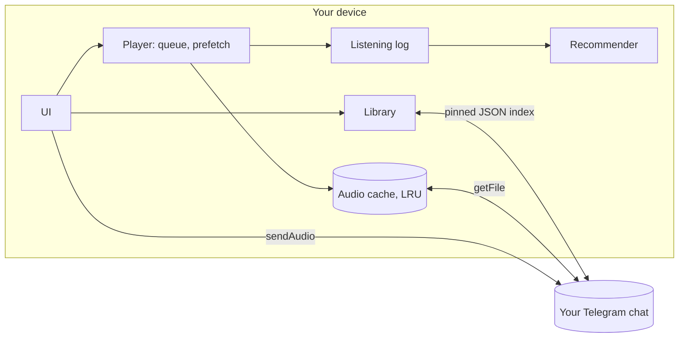

# ChatTunes

[](https://github.com/kuanysh228/chattunes/actions/workflows/ci.yml)


A serverless music player that uses **your own Telegram chat as the library**.
Every device is its own server: it downloads, caches, tracks your listening and recommends music.

Drop a track into the chat and it shows up on all your devices. No accounts, no subscriptions,
no third-party servers: just your bot and your chat.

> **Status:** early (v0.1). Linux only so far. The core Bot API flow (index sync, download) is
> verified against the real API; see the [TODO](TODO.md) for what is still unchecked and what is next.

## Features

| | |
|---|---|
| **Library** | Search, sort (newest, title, artist, most played), favorites filter |
| **Playlists & favorites** | Create, rename, drag to reorder. Synced across devices |
| **Player** | Draggable queue, shuffle, repeat (off / all / one), play next, mini player |
| **Prefetch** | The next 1-5 queue items download ahead of time, so skipping never waits |
| **Offline** | Keep favorites and chosen playlists on the device; cache is capped with LRU eviction |
| **Stats** | Listening time, plays, day streak, skip rate, charts by day and hour, top tracks and artists |
| **Recommendations** | Daily mix, "Haven't heard in a while", "New from artists you love", autoplay |

## How it works



- **Storage** is the audio messages in your chat. The bot downloads them through the Bot API.
- **Sync** works through a single JSON document pinned in the chat. It holds the library, favorites,
  playlists and removals. The app edits that message in place, so groups do not fill up with
  "pinned a message" service posts.
- **Conflicts** resolve without a server: the latest edit of each item wins, and a removed track
  stays removed until it is uploaded again.
- **Stats and recommendations** live on the device only. Your listening history never leaves it.

### How recommendations work

No audio features and no network, just your history: plays, skips and favorites.

- a listen loses half of its weight every 30 days;
- artists and tracks you play rise, tracks you keep skipping sink;
- time of day matters, and so does what usually plays *after* the current track;
- anything played in the last hours is pushed down for a while;
- one artist cannot fill the whole mix;
- with little history, it falls back to the newest tracks in your library.

## Quick start

1. Create a bot with [@BotFather](https://t.me/BotFather) and copy its token.
2. Create a channel or group and add the bot as an **administrator**
   (post, pin and delete messages).
3. Start the app, paste the token and the chat id (`@username` or `-100...`).
4. Add tracks with the **+** button, or just post audio into the chat.

## Building

Requires [Flutter](https://docs.flutter.dev/get-started/install) (stable).

```bash
flutter pub get
flutter run -d linux           # run
flutter build linux --release  # build
```

Linux needs `clang`, `cmake`, `ninja`, `gtk3` and `mpv` (playback goes through libmpv):

```bash
# Arch
sudo pacman -S clang cmake ninja gtk3 mpv
```

## Tests

```bash
flutter analyze
flutter test
```

Tests cover cross-device merging, stats, recommendations, the cache, and the Bot API client
(against a local fake server that mirrors the real behavior).

## Project layout

| Path | Contents |
|---|---|
| `lib/telegram_api.dart` | Bot API client: upload, download, polling, index |
| `lib/sync_data.dart` | Synced data model and merge rules |
| `lib/library_store.dart` | Library, favorites, playlists, sync loop |
| `lib/player_service.dart` | Queue, playback, prefetch, offline, listening log |
| `lib/recommender.dart` | Recommendations |
| `lib/stats.dart` | Listening log and aggregates |
| `lib/cache_manager.dart` | Least-recently-used cache eviction |
| `lib/screens/` | Screens |
| `test/` | Tests, including the fake Bot API |

> The project used to be called TeleMusic. The Dart package name (`telemusic`), the app id and the
> index file name (`telemusic_library.json`) are unchanged on purpose, so existing settings and
> libraries already stored in a chat keep working.

## Limitations

- **Files over 20 MB cannot be downloaded.** That is a Bot API limit; such tracks are flagged with an error.
- If you post tracks into the chat by hand, open the app at least once a day: Telegram keeps
  unprocessed updates for 24 hours. Tracks uploaded through the app are not affected.
- The bot token is stored on the device in app settings, **unencrypted**.
  Use a dedicated bot for the player.
- Stats are not synced, so recommendations differ per device.
- A listen cut short by closing the app is not recorded.
- The UI is currently in Russian only.

## Related projects

- [abn3li/TeleMusic](https://github.com/abn3li/TeleMusic): a native Android app (Kotlin, TDLib)
  that also turns a Telegram channel into a music library, with a much larger feature set.
  ChatTunes differs in using a bot token instead of a user session, running on desktop, and
  keeping everything on-device.

## License

[MIT](LICENSE) © 2026 Kuanysh. Do whatever you want with it, just keep the copyright notice.
