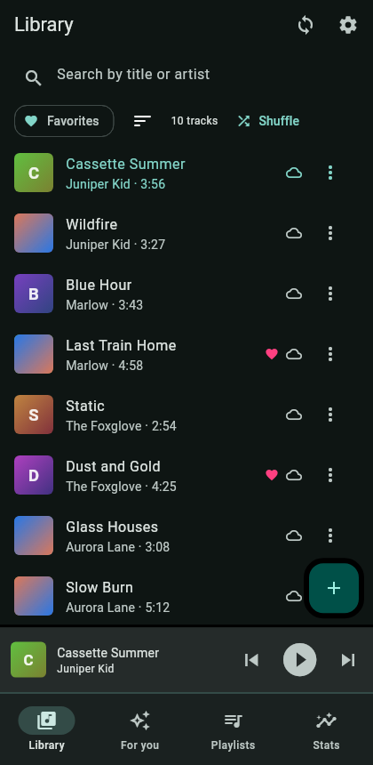
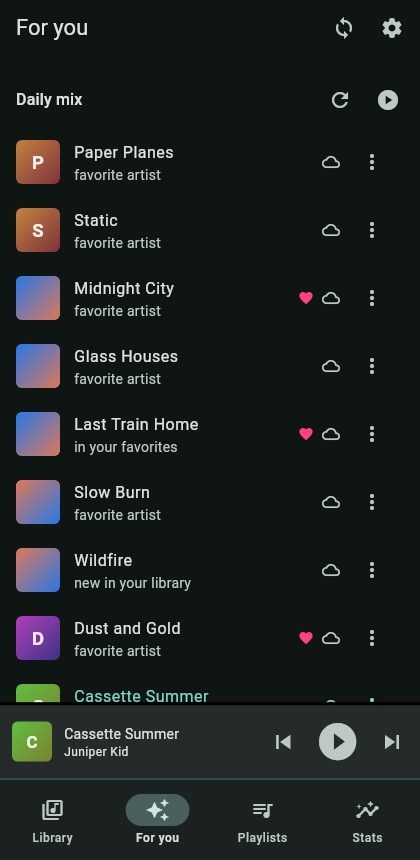
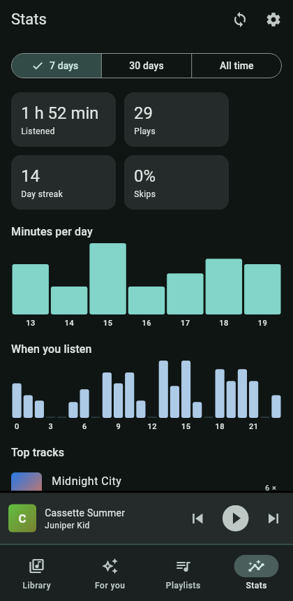
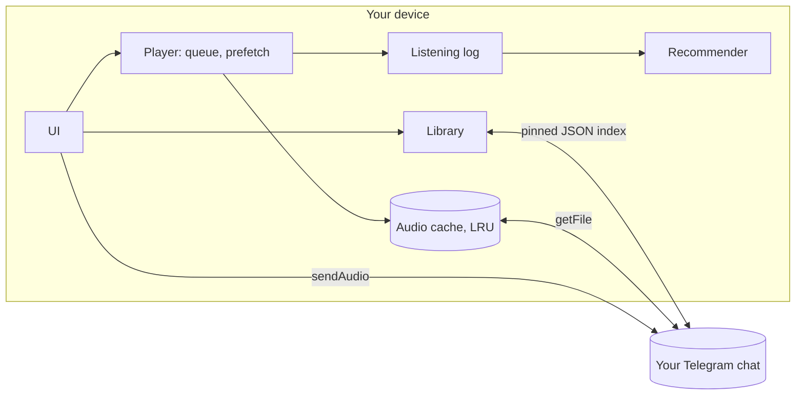

# ChatTunes

[](https://github.com/kuanysh228/chattunes/actions/workflows/ci.yml)


A serverless music player that uses **your own Telegram chat as the library**.
Every device is its own server: it downloads, caches, tracks your listening and recommends music.

Drop a track into the chat and it shows up on all your devices. No accounts, no subscriptions,
no third-party servers: just your bot and your chat.

> **Status:** early (v0.1). Linux only so far. The core Bot API flow (index sync, download) is
> verified against the real API; see the [TODO](TODO.md) for what is still unchecked and what is next.

## Features

| | |
|---|---|
| **Library** | Search, sort (newest, title, artist, most played), favorites filter. Title, artist, duration and **cover art are read from the file's own tags** |
| **Playlists & favorites** | Create, rename, drag to reorder. Synced across devices |
| **Smart playlists** | Fill themselves: most played this month, recently added, never played, loved the most, often skipped |
| **Player** | Draggable queue, shuffle, repeat (off / all / one), play next, mini player |
| **Prefetch** | The next 1-5 queue items download ahead of time, so skipping never waits |
| **Offline** | Keep favorites and chosen playlists on the device; cache is capped with LRU eviction |
| **Stats** | Listening time, plays, day streak, skip rate, charts by day and hour, top tracks and artists. **Shared across your devices** |
| **Recommendations** | Daily mix, a mix for the time of day you usually listen to it, "Haven't heard in a while", "New from artists you love", autoplay |
| **Desktop integration** | Media keys, the desktop's player widget and `playerctl` work (MPRIS on Linux) |
| **Languages** | English and Russian, following the system language. [Adding one](docs/LOCALIZATION.md) is a single file |
| **Themes** | A theme is one JSON file: colors, shapes, and the **layout** itself. Move the player to the top or a side panel, reorder tabs, pick the controls. Edit the file and the app restyles live |

<p>
  
  
  
  
</p>

<sub>Screenshots are rendered from sample data by `flutter test test_visual`.</sub>

## Make it yours

The whole look is data. Themes can recolor the app and also **rearrange it**: here the player sits at
the top, there it is a panel on the right of a desktop layout.

```json
{
  "format": 1,
  "name": "Ocean",
  "colors": { "seed": "#0288D1" },
  "shape": { "radius": 20, "coverRadius": 0.5 },
  "layout": { "shell": { "column": ["header", "player", "content", "navigation"] } }
}
```

Drop the file in the themes folder (Settings, Theme shows where) and save: the app updates instantly.
Share a theme by sending the JSON or by opening a pull request.

- [docs/THEMING.md](docs/THEMING.md): the full theme format and examples
- [docs/LOCALIZATION.md](docs/LOCALIZATION.md): adding a language
- [docs/UI.md](docs/UI.md): how the UI code is organized, for changing more than a theme can
- [themes/](themes): the bundled themes, which double as examples


## How it works



- **Storage** is the audio messages in your chat. The bot downloads them through the Bot API.
- **Sync** works through a single JSON document pinned in the chat. It holds the library, favorites,
  playlists, removals and the listening logs of your devices. The app edits that message in place, so groups do not fill up with
  "pinned a message" service posts.
- **Conflicts** resolve without a server: the latest edit of each item wins, and a removed track
  stays removed until it is uploaded again.
- **Stats and recommendations** are computed on your device from your listening history. The history
  itself travels only through your own chat, between your own devices, so stats and recommendations
  match everywhere. Resetting stats clears it on every device.

### How recommendations work

No audio features and no network, just your history: plays, skips and favorites.

- a listen loses half of its weight every 30 days;
- artists and tracks you play rise, tracks you keep skipping sink;
- time of day matters, and so does what usually plays *after* the current track;
- anything played in the last hours is pushed down for a while;
- one artist cannot fill the whole mix;
- with little history, it falls back to the newest tracks in your library.

## Quick start

1. Create a bot with [@BotFather](https://t.me/BotFather) and copy its token.
2. Create a channel or group and add the bot as an **administrator**
   (post, pin and delete messages).
3. Start the app, paste the token and the chat id (`@username` or `-100...`).
4. Add tracks with the **+** button, or just post audio into the chat.

## Building

Requires [Flutter](https://docs.flutter.dev/get-started/install) (stable).

```bash
flutter pub get
flutter run -d linux           # run
flutter build linux --release  # build
```

Linux needs `clang`, `cmake`, `ninja`, `gtk3`, `libsecret` and `mpv` (playback goes through libmpv, and
the bot token is kept in the system keychain):

```bash
# Arch
sudo pacman -S clang cmake ninja gtk3 libsecret mpv

# Debian / Ubuntu
sudo apt install clang cmake ninja-build libgtk-3-dev libsecret-1-dev libmpv-dev
```

## Tests

```bash
flutter analyze
flutter test                # unit, layout, sync and translation tests
flutter test test_visual    # screenshots of every theme, in build/screenshots/
```

Two checks need something from the machine and skip themselves when it is missing: the MPRIS test uses a
D-Bus session and `playerctl`. And `test_real/` runs against a real bot and chat, only if you provide
`TG_TOKEN` and `TG_CHAT`; it leaves the chat as it found it.

Tests cover cross-device sync end to end (two simulated devices on one fake chat), merging, stats and
listening history, recommendations, smart playlists, the cache, tag and cover reading, the keychain
fallback, MPRIS on the real session bus, the theme format, translations, and where the UI puts things
for different layouts.

## Project layout

| Path | Contents |
|---|---|
| `lib/telegram_api.dart` | Bot API client: upload, download, polling, index |
| `lib/sync_data.dart` | Synced data model and merge rules |
| `lib/library_store.dart` | Library, favorites, playlists, sync loop |
| `lib/player_service.dart` | Queue, playback, prefetch, offline, listening log |
| `lib/recommender.dart` | Recommendations, including time-of-day mixes |
| `lib/smart_playlists.dart` | Self-filling playlists |
| `lib/audio_tags.dart` | Reads tags and cover art from audio files |
| `lib/token_store.dart` | Bot token in the system keychain, with a fallback |
| `lib/mpris.dart` | Media keys and desktop player widget (Linux) |
| `lib/stats.dart` | Listening log and aggregates |
| `lib/cache_manager.dart` | Least-recently-used cache eviction |
| `lib/ui/theme/` | Theme format, design tokens, theme loading |
| `lib/ui/components/` | Reusable UI building blocks |
| `lib/ui/screens/` | Screens |
| `lib/l10n/` | Translations (`.arb` files) |
| `themes/` | Bundled themes and examples |
| `docs/` | Theming and UI guides, theme JSON schema, screenshots |
| `test/` | Tests, including the fake Bot API and layout tests |
| `test_visual/` | Renders screens and themes to images, no device needed |
| `test_real/` | Opt-in checks against a real Telegram bot |

> The project used to be called TeleMusic. The Dart package name (`telemusic`), the app id and the
> index file name (`telemusic_library.json`) are unchanged on purpose, so existing settings and
> libraries already stored in a chat keep working.

## Limitations

- **Files over 20 MB cannot be downloaded.** That is a Bot API limit; such tracks are flagged with an error.
- If you post tracks into the chat by hand, open the app at least once a day: Telegram keeps
  unprocessed updates for 24 hours. Tracks uploaded through the app are not affected.
- The bot token is kept in the system keychain (GNOME Keyring, KWallet). If there is none, it falls back
  to the app's settings file, **unencrypted**, and Settings tells you which one is in use. Use a
  dedicated bot for the player either way.
- Media keys are Linux-only for now (MPRIS); Android and Windows need their own integration.
- Listening logs are shared at most every 30 minutes, and when the app goes to the background, so another
  device can be a little behind on stats.

## Related projects

- [abn3li/TeleMusic](https://github.com/abn3li/TeleMusic): a native Android app (Kotlin, TDLib)
  that also turns a Telegram channel into a music library, with a much larger feature set.
  ChatTunes differs in using a bot token instead of a user session, running on desktop, and
  keeping everything on-device.

## License

[MIT](LICENSE) © 2026 Kuanysh. Do whatever you want with it, just keep the copyright notice.
