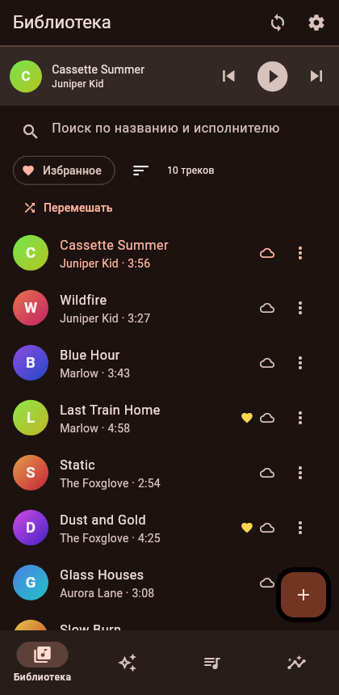
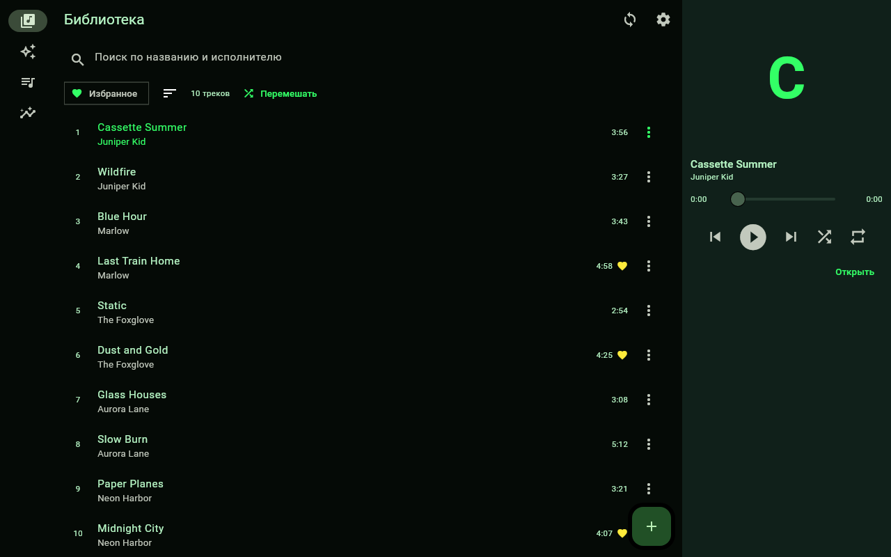

# Theming

A ChatTunes theme is **one JSON file**. It can change colors, shapes, spacing and font size, and it can
**rearrange the screen**: put the player at the top, dock it as a side panel, move the navigation,
hide or reorder tabs, choose which buttons appear and in what order.

Themes are plain data. A theme file never runs code, so importing one from someone else is safe.




## Make your first theme in two minutes

1. Open **Settings, Theme**, then the **⋮** menu, and choose **Copy current theme (JSON)**.
   (The app UI is Russian for now, so the menu reads «Скопировать текущую (JSON)».)
2. Save it as a `.json` file in the themes folder. The folder path is shown at the top of the Theme screen.
3. Edit the file and save. The app restyles itself instantly, no restart needed.

You can also paste a theme from the clipboard (**⋮, Paste from clipboard**) or import a file.
The exported JSON lists every option, so it doubles as a template.

If a file has a mistake, the Theme screen lists every problem in it, and the app falls back to the
default theme instead of crashing. Fix the file and save again.

### Editor autocomplete

Add `"$schema"` to the top of your theme and editors such as VS Code will complete and validate keys:

```json
{
  "$schema": "https://raw.githubusercontent.com/kuanysh228/chattunes/main/docs/theme.schema.json",
  "format": 1,
  "name": "My Theme"
}
```

(While the repository is private, point `$schema` at your local copy of `docs/theme.schema.json` instead.)

## A small example

```json
{
  "format": 1,
  "name": "Ocean",
  "author": "you",
  "brightness": "dark",
  "colors": { "seed": "#0288D1", "favorite": "#FFCA28" },
  "shape": { "radius": 20, "coverRadius": 0.5 },
  "layout": {
    "shell": { "column": ["header", "player", "content", "navigation"] }
  }
}
```

Only `name` is required. Everything you leave out keeps its default.

## Reference

### Top level

| Key | Values | Notes |
|---|---|---|
| `format` | `1` | Theme format version. A newer number than the app supports is rejected |
| `name` | text | Required. Shown in the theme list |
| `author`, `description` | text | Optional |
| `brightness` | `"dark"` (default), `"light"` | |

### `colors`

Colors are written `#RGB`, `#RRGGBB` or `#RRGGBBAA`.

Set **`seed`** and the whole palette is generated from it. Then override any single color:

`primary`, `onPrimary`, `secondary`, `onSecondary`, `tertiary`, `onTertiary`, `error`, `onError`,
`surface` (app background), `onSurface` (main text), `surfaceContainer`, `surfaceContainerHigh`
(player, cards, menus), `outline`.

ChatTunes adds a few of its own: `favorite` (the heart), `onCover` (letter drawn on covers),
`chartPrimary`, `chartSecondary` (statistics charts).

If text would be hard to read, the theme still loads but shows a warning with the contrast ratio.

### `shape`

| Key | Range | Default | |
|---|---|---|---|
| `radius` | 0 to 32 | 14 | Cards, dialogs, sheets, buttons |
| `coverRadius` | 0 to 0.5 | 0.14 | Fraction of the cover size. `0.5` is a circle |

### `spacing`

| Key | Range | Default | |
|---|---|---|---|
| `pad` | 8 to 32 | 16 | Outer padding of screens and sections |
| `gap` | 4 to 16 | 8 | Gap between related elements |
| `density` | `comfortable`, `standard`, `compact` | `comfortable` | Height of rows and controls |

### `typography`

| Key | Range | Default | |
|---|---|---|---|
| `scale` | 0.8 to 1.3 | 1.0 | Multiplies every font size |

### `cover`

There is no real artwork yet, so covers are generated from the track.

| Key | Values | Default |
|---|---|---|
| `style` | `gradient`, `solid`, `flat` | `gradient` |
| `saturation` | 0 to 1 | 0.45 |
| `lightness` | 0.1 to 0.9 | 0.35 |

## Layout

Everything under `layout` is optional.

### `shell`: where the main parts go

The main screen has four **regions**:

| Region | What it is |
|---|---|
| `header` | Screen title with the sync and settings buttons. Required |
| `content` | The current tab. Required |
| `navigation` | Tab switcher. Required when there is more than one tab |
| `player` | The compact player. Optional |

You arrange them with nested `row` and `column` boxes. Each region may appear at most once, and boxes
can nest up to 4 levels deep.

The regions adapt to where you put them. **In a column** the navigation is a bar and the player a
strip. **In a row** the navigation becomes a rail and the player a side panel.

```json
// Player at the top, navigation at the bottom
"shell": { "column": ["header", "player", "content", "navigation"] }

// Navigation on top
"shell": { "column": ["navigation", "header", "content", "player"] }

// Desktop: rail on the left, player panel on the right
"shell": { "row": ["navigation", { "column": ["header", "content"] }, "player"] }
```

**Phones and desktops.** `shell` applies at every width unless you also give `shellWide`, which
applies from 800 px up. A side panel needs room, so a layout with the player in a row should be a
`shellWide`, with a column `shell` for phones:

```json
"shell": { "column": ["header", "content", "player", "navigation"] },
"shellWide": { "row": ["navigation", { "column": ["header", "content"] }, "player"] }
```

If you give neither, ChatTunes uses its default: bars at the bottom on a phone, a rail on the left on
a desktop.

### `tabs`

Which tabs exist and in what order: `library`, `forYou`, `playlists`, `stats`. Leave one out to hide it.

```json
"tabs": ["library", "playlists"]
```

`navigationLabels` is `"always"` (default), `"selected"` or `"never"`.

### `player`: the compact player

| Key | Values | Default |
|---|---|---|
| `style` | `raised`, `flat` | `raised` |
| `progress` | `top`, `bottom`, `hidden` | `bottom` |
| `controls` | list, see below | `["previous", "play", "next"]` |
| `showCover` | `true`, `false` | `true` |

In a side panel, `progress: "hidden"` removes the seek bar.

### `nowPlaying`: the full player screen

| Key | Values | Default |
|---|---|---|
| `arrangement` | `vertical`, `horizontal` | `vertical` |
| `controls` | list | `["shuffle", "previous", "play", "next", "repeat"]` |

`horizontal` puts the cover next to the controls. It needs about 560 px, and narrower screens fall
back to `vertical`.

**Control buttons** are chosen from `previous`, `play`, `next`, `shuffle`, `repeat`, `favorite`,
`queue`, shown in the order you list them. A `play` button must exist in at least one of the two
lists, so playback can always be controlled.

### `trackRow`: rows in track lists

| Key | Values | Default |
|---|---|---|
| `leading` | `cover`, `number`, `none` | `cover` |
| `coverSize` | 28 to 80 | 44 |
| `subtitle` | list of `artist`, `duration` | `["artist", "duration"]` |
| `trailing` | list of `favorite`, `status`, `duration`, `menu` | `["favorite", "status", "menu"]` |

## Built-in themes

The files in [`themes/`](../themes) are bundled with the app and double as examples:

| Theme | Shows off |
|---|---|
| `chattunes-dark`, `chattunes-light` | The defaults |
| `amoled` | Custom surface colors, sharp corners, solid covers |
| `sunset` | Player at the top, round covers, flat player |
| `terminal` | Square corners, dense list, numbered rows, rail left and player panel right on desktop |
| `paper` | Light, large rounded covers, side-by-side Now Playing |

## Sharing a theme

- Send the JSON. The receiver pastes it in **⋮, Paste from clipboard**.
- Or open a pull request adding your file to [`themes/community/`](../themes/community). Themes there
  are bundled with the app.

## Previewing without a device

```bash
flutter test test_visual
```

renders every theme in `themes/` on sample data into `build/screenshots/` (phone and desktop). Add
your theme to `themes/` and it will show up. No Telegram bot is needed.

## Limits, and how to go further

A theme can move and restyle the existing pieces, but it cannot add new ones or change how a widget is
drawn. If you want something a theme cannot express yet, for example a new region or a different
cover shape, add it to the code. The UI is built to make that easy: see [UI.md](UI.md).
